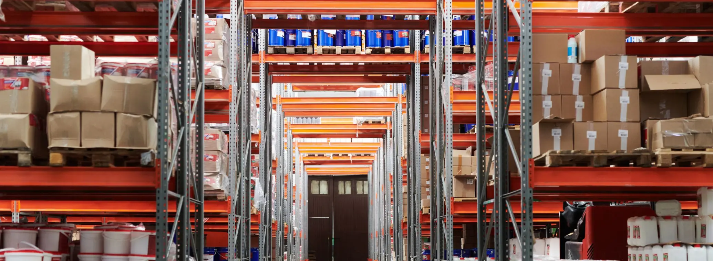

# AliExpress or CJ Dropshipping vs Your Own Stock in a China Warehouse

> **Quick answer:** **AliExpress dropshipping** is the cheapest way to test products, but every order depends on a different seller's stock, quality and packing. **A dropshipping agent such as CJ Dropshipping** adds sourcing, its own warehouses and the option to store products you own. **Your own stock in a China 3PL** costs cash up front but gives you full control: the factory, the quality check, your packaging and consistent customs data. All three ship from China and all three pay US duty on every parcel now. Test with dropshipping, then move proven products into your own stock.

Most dropshipping stores start on AliExpress, and many move to an agent like CJ Dropshipping when they want faster processing and fewer suppliers to manage. The next step after that is holding your own stock in a warehouse in China.

Each of the three works. They suit different stages of a store. This post compares them fairly, including where each one beats the others.

## The three models

**AliExpress dropshipping.** You list products from AliExpress sellers in your store. When a customer orders, you place the same order with the seller, who packs and ships it to your customer. You never hold stock, and each product may come from a different seller.

**A dropshipping agent, such as CJ Dropshipping.** The agent sources products from factories, holds them in its own warehouses and ships your orders. CJ's website, as at 8 November 2026, says it has **more than 10 warehouses worldwide** and offers a 3PL service for **your own products stocked in its warehouses**. It also lists product sourcing. Other agents work in a similar way.

**Your own stock in a China 3PL.** You buy stock from a factory you have chosen. It is shipped to the 3PL's warehouse, counted and inspected, and stored. The 3PL picks, packs and ships each order to your instructions, in your packaging. The 3PL is built around your inventory rather than a product catalogue.

## Side by side

| | AliExpress dropshipping | Dropshipping agent (e.g. CJ) | Own stock in a China 3PL |
|---|---|---|---|
| Upfront cash | None | None, or stock you choose to buy | Stock bought up front |
| Product source | Many independent sellers | The agent's sourcing, or your stock | Your factory, your spec |
| Quality check before shipping | Rarely | Varies by service | Every delivery inspected on arrival |
| Packaging | The seller's | The agent's; ask about custom options | Yours, packed at the standard rate |
| Customs data per product | Set by each seller | Set by the agent | Kept consistent, per product |
| Product range | Huge | Large | What you stock |
| Best for | Testing products | Scaling tests with less admin | Proven products and a real brand |

## Where each one wins

**AliExpress wins on testing.** No minimums, no stock and a huge range. If you do not yet know what sells, nothing is faster or cheaper for finding out.

**An agent wins on convenience while you are still growing.** One supplier instead of many, sourcing done for you, and the option to start holding some stock without changing provider. If your catalogue is large and still changing, an agent can be the sensible middle step.

**Your own stock in a 3PL wins on control.** When the product is proven, the things that build a brand all depend on owning it:

- **Quality.** You choose the factory and the spec, and every delivery is counted against your purchase order and inspected before it is stored.
- **Packaging.** Branded mailers, boxes, inserts and thank-you cards, packed into every order. We do this at the standard **$0.99 per order** pick and pack rate.
- **Customs data.** The same description, HTS code and value on every parcel, which keeps clearance smooth and duty correct.
- **Supply.** You can see stock levels and reorder before you run out, and you are not exposed to a seller delisting your bestseller.

## The duty question

Since the US de minimis exemption was suspended, **every parcel from China to a US customer pays duty**: the normal MFN rate, any Section 301 list duty and the 12.5% Section 301 forced labor duty. That is true for all three models. The exemption is repealed in law from 1 July 2027, so plan as if it is not coming back.

What differs is how the duty is handled. Ask any provider:

1. **Who sets the HTS code and description** on each parcel?
2. **Is the parcel shipped DDP**, so the duty is paid before delivery, or DAP, so your customer is billed at the door?
3. **Who keeps the records** if customs asks questions later?

Our post on [shipping D2C orders to the US in 2027](shipping-d2c-orders-china-to-us-2027.html) goes through what each parcel pays.

## What changes in your costs

With dropshipping, product, packing and shipping are bundled into one price per order. With your own stock, they are separate:

| Line | Own stock with us |
|---|---|
| Stock | Bought from the factory, up front |
| Receiving and standard inspection | Free |
| Storage | $0.49 per CBM per day; 30 days free for new customers when the first order ships within those 30 days |
| Pick and pack, standard packaging included | $0.99 per order |
| Shipping | Quoted per shipment |

The trade is cash for control. You pay for stock before you sell it, so start with the products you are sure of. Our [pricing guide](china-fulfillment-cost-pricing-2026.html) works through a full order.

## How to move across

1. **Choose two or three proven products.** Keep everything else where it is.
2. **Find the factory.** Your agent may introduce you, or you can source directly. Get samples and compare them with what customers have been receiving.
3. **Order a small first batch** and have it shipped to the 3PL.
4. **Route only those products** to the 3PL in your store. Shopify and similar platforms can assign products to different fulfilment locations.
5. **Compare for a month**: refunds, reviews, delivery times and margin.
6. **Move the next products** once the first batch is working.

Our post on [when to switch from dropshipping to a China 3PL](switch-from-dropshipping-to-china-3pl.html) covers the signs that you are ready, and our guide to [moving to a branded D2C store](dropshipping-to-branded-d2c-store.html) covers the brand side.

## Where we sit in this

We are a China 3PL, not a dropshipping agent and not a product marketplace. We hold stock you own in our Shenzhen warehouse, check it on arrival, and ship each order in your packaging, with DDP to the main markets. Pick and pack is **$0.99 per order** with standard packaging included, receiving is free and there are no minimums. If you are still testing products, AliExpress or an agent will suit you better for now, and we would rather tell you that than take on stock that does not move.

## The bottom line

AliExpress is for testing, an agent like CJ is for scaling those tests with less admin, and your own stock in a China 3PL is for products you are building a brand on. All three ship from China and all three pay US duty on every parcel. The difference is who controls the product, the packaging and the customs data.

[Tell us which products you want to move](Contact-Us.html) and we will cost them out against what you pay now.

Company details are as stated on each provider's website at 8 November 2026. Services change, so confirm them with the provider before you decide.
