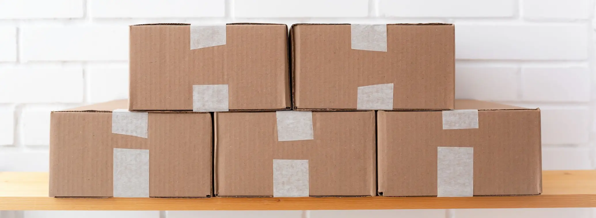

# Best Crowdfunding Fulfillment Companies (2027): An Honest Comparison for Kickstarter and Indiegogo Creators

> **Quick answer:** The best crowdfunding fulfillment company depends on where your rewards are made and where your backers are. **Fulfillrite** fulfils from the US and states it has fulfilled more than 3,500 Kickstarter campaigns. **GamesQuest** specialises in tabletop and crowdfunding fulfilment with UK and EU operations. **SendFromChina, ChinaDivision, NextSmartShip and us** ship rewards straight from China, where most are made; NextSmartShip states it is an official partner of Kickstarter and Indiegogo. **Easyship** is shipping software with crowdfunding tools. Choose before you launch, and ship DDP so backers never pay duty at the door.

Crowdfunding fulfillment is not ordinary ecommerce fulfillment. Thousands of orders arrive at once, every backer's reward is different, add-ons get bolted on in the pledge manager, and backers in 40 countries all want their parcel at the same time with nothing to pay on delivery.

Search for the best crowdfunding fulfillment company and you will find several "top" lists, most written by a fulfillment company. This one is too. So we have not ranked anyone. We have set out what each company states it does, and where the others are a better choice than we are.

## First, where the rewards start

The biggest decision is not which company, but where the rewards ship from.

| | Ship from the factory country | Ship from regional hubs |
|---|---|---|
| **How it works** | Rewards are packed near the factory and each backer's parcel ships direct | Stock is freighted in bulk to warehouses in the US, UK or EU, then packed and shipped locally |
| **Best when** | Backers are spread across many countries | Most backers are in one or two regions |
| **Delivery to backers** | Days to a couple of weeks, depending on the service | Domestic speed once the stock has landed |
| **Duty** | On each backer's parcel | On the bulk import into each region |
| **Extra steps** | None before packing | Freight, customs and receiving in each region |

Most crowdfunded products are made in China, which is why China-based fulfillment has become a common choice. Our guide on [how to fulfil Kickstarter orders from China](how-to-fulfil-kickstarter-orders-from-china.html) walks through the process.

## Pledge managers are not fulfillment

A pledge manager, such as BackerKit, PledgeBox or Kickstarter's own pledge manager, collects backer addresses, reward choices and add-ons. A fulfillment company stores the stock, assembles each backer's reward and ships it. You need both, and the fulfillment company should be able to import the pledge manager's export directly. We take CSV exports from BackerKit, PledgeManager, PledgeBox and Kickstarter.

## The companies, by what they are built for

Every figure below is what the company states about itself on its own website, as at 8 November 2026. We have not audited any of them, including ourselves.

| Company | Ships from | As the company states it |
|---|---|---|
| **Fulfillrite** | United States (New Jersey) | "3500+ Kickstarter campaigns fulfilled", discounted shipping rates "including international shipping", custom quotes |
| **GamesQuest** | UK, with EU and rest-of-world fulfilment updates | Crowdfunding and tabletop fulfilment "to backers across the world", covering "logistics to VAT reporting, General Product Safety Regulation and more" |
| **SendFromChina (SFC)** | China | "Custom platform to manage all crowdfunding fulfillment process", "DDP and DDU services", a board game fulfillment service, parent listed on ChiNext |
| **ChinaDivision** | China | Batch fulfillment for Kickstarter and Indiegogo with "Elastic capacity for launch order surges", ISO 9001:2015, pick and pack "From $0.59 / order" |
| **NextSmartShip** | China plus 12 other countries | "Official partner of Kickstarter and Indiegogo", "20+ warehouses worldwide" |
| **Easyship** | Shipping software with a fulfillment network | Crowdfunding shipping, "Easyship Collect for Crowdfunding", a crowdfunding calculator, "550+ Courier Services" |
| **China Fulfillment International** | China | Shenzhen, established 2010, reward kitting by tier, DDP on major routes, pledge manager CSV imports, pick and pack $0.99 per order |

## Where the others beat us

**If most of your backers are in the US and your stock is already there, a US fulfillment company wins.** Fulfillrite fulfils from New Jersey and states more than 3,500 Kickstarter campaigns fulfilled. Domestic US delivery is faster than shipping each reward from China.

**For tabletop campaigns with many European backers, a UK and EU specialist deserves a look.** GamesQuest builds its service around games and states it covers VAT reporting and the EU's General Product Safety Regulation.

**If you want a fulfillment company that is an official platform partner, NextSmartShip states it is one** for both Kickstarter and Indiegogo. We are not.

**For board games specifically, SFC runs a dedicated service.** Board games have their own handling quirks, from component counts to box crush.

**On the headline pick and pack rate, two China-based companies quote lower.** ChinaDivision lists "From $0.59 / order" and NextSmartShip "$0.5 first pick, $0.1 / additional pick per order". Ours is $0.99 per order with standard packaging included. Kitting multi-item reward tiers is priced separately everywhere, so compare the whole reward, not the headline.

## Where we are genuinely different

**Kitting by tier, checked at the source.** We assemble each backer's reward to their tier and add-ons, and inspect the stock on arrival, with photos, before anything ships. Kitting and bundling is from **$0.50 per unit**. Our [crowdfunding fulfillment](china-crowdfunding-fulfillment.html) page shows the process.

**Our prices are public**, including storage at **$0.49 per CBM per day**, so you can put real numbers in your campaign spreadsheet before you speak to anyone. New customers get 30 days free storage when their first order ships within those 30 days.

**DDP so backers pay nothing at the door.** Every parcel from China to the US now pays duty, and the UK, EU, Canada and Australia each have their own rules. Our post on [Kickstarter and Indiegogo shipping and duties in 2027](kickstarter-indiegogo-shipping-duties-2027.html) explains them by country.

**Battery paperwork handled.** Many campaigns are gadgets with lithium batteries, and we prepare the MSDS and UN38.3 documentation they need. See our post on [shipping batteries and electronics](shipping-batteries-electronics-from-china-2026.html).

## How to choose, in six questions

1. **Where are your rewards made?** If in China, ask whether they need to leave China before they are packed.
2. **Where are your backers?** Pull the country split from your campaign dashboard.
3. **How complex are the tiers?** Many add-ons and variants need a company that kits by tier and imports pledge data cleanly.
4. **What will backers pay at the door?** Ask every company whether it ships DDP to your main backer countries.
5. **Does the product contain batteries or liquids?** Ask how the company handles the paperwork.
6. **What is the full cost per backer?** Pick and pack, kitting, storage, packaging, shipping and duty together.

Ask before you launch. The fulfillment quote sets your shipping charges, and changing them after the campaign is painful.

## Where we sit in this, and where we do not

We are one of the companies in this comparison, and we wrote it. We have used each company's own published claims and been plain about where the others are a better fit, but read it knowing who wrote it and check anything important directly with each company. We have not included every crowdfunding fulfillment company; we have kept to the ones most often weighed up by creators whose rewards are made in China or shipped worldwide.

## The bottom line

The best crowdfunding fulfillment company is the one built for where your rewards are made and where your backers live. Mostly US backers with stock in the US: a US company. Many European tabletop backers: a UK and EU specialist. Rewards made in China for backers everywhere: ship them from China, kitted by tier and DDP.

If that last one sounds like your campaign, [send us your backer count, tiers and countries](Contact-Us.html). If it does not, one of the others above is likely a better fit, and we would rather tell you now.

Company details are as each company states them on its own website at 8 November 2026. Services and figures change, so confirm them with the company before you decide.
