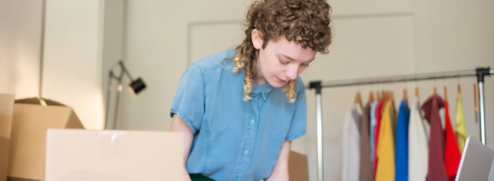

# Best Shopify Fulfillment for Brands Sourcing from China (2027): An Honest Comparison

> **Quick answer:** If your products are made in China, the best Shopify fulfillment depends on where your customers are and how fast they expect delivery. **China-based 3PLs** such as ChinaDivision, SendFromChina, NextSmartShip and us ship each order direct from where the goods are made, which suits light, varied and new products. **US and global 3PLs** such as ShipBob and ShipMonk hold stock near customers, which suits heavy bestsellers that need two-day delivery. The **Shopify Fulfillment Network app** connects you to a 3PL partner from your admin. Many brands run a **hybrid** of the two.

Most "best Shopify fulfillment" lists assume your stock is already in the US. If your products are made in China, that assumption skips the first and most expensive decision: whether to bring the stock to your customers' country at all, or ship each order from where it was made.

This comparison starts with that decision. We are one of the providers in it, so we have used each company's own published claims and included where the others are the better choice.

## First, three ways to fulfil Shopify orders when you source from China

| | Ship direct from China | Bulk import, fulfil near customers | Hybrid |
|---|---|---|---|
| **How it works** | Stock stays in a China warehouse; each order ships as its own parcel | Stock goes by sea or air to a 3PL in your market; orders ship domestically | Bestsellers near customers, the rest from China |
| **Delivery** | Days, not hours: our standard is 6–10 days to the US | Domestic speed, often two days | Both, by product |
| **US duty** | On each parcel's retail value | Once, on the wholesale value of the bulk import | Both |
| **Cash tied up** | Low: stock stays at the source | Higher: stock bought and shipped months ahead | In between |
| **Best for** | Light, higher-margin, varied or new products | Heavy, low-margin bestsellers | Most growing brands |

Our post on the [China and US hybrid model](china-us-hybrid-fulfillment-model-2026.html) goes deeper into the split, and our [D2C vs US 3PL cost audit](direct-from-china-d2c-vs-us-3pl-2026.html) shows the numbers.

## The providers, by what they are built for

Every figure below is what the company states about itself on its own website, as at 8 November 2026. We have not audited any of them, including ourselves, and you should verify anything that matters to your decision.

| Provider | Model | As the company states it |
|---|---|---|
| **ShipBob** | US and global 3PL | Ships from "50+ global locations" in the US, Canada, the UK, the Netherlands, Spain and Australia; fees quoted per customer |
| **ShipMonk** | US-based 3PL | "12+ fulfillment centers on 7 campuses", US sites in Nevada, Texas, Kentucky and Pennsylvania, "4,400+ brands", cross-border DDP |
| **Shopify Fulfillment Network** | App connecting you to 3PL partners | Installed from the Shopify App Store; you choose a 3PL partner and manage fulfillment from the Shopify admin |
| **ChinaDivision** | China 3PL | Shenzhen, 20,000 m²+, "8,000+ brands", ISO 9001:2015, one-click Shopify integration, pick and pack "From $0.59 / order" |
| **SendFromChina (SFC)** | China 3PL | Over 40,000 m³ of storage, parent listed on ChiNext, SFC Shopify app |
| **NextSmartShip** | Hybrid 3PL | "20+ warehouses" across 13 countries including China and the US, one-click Shopify connection, "No minimum commitment" for early-stage brands, handling "$0.5 first pick, $0.1 / additional pick per order" |
| **China Fulfillment International** | China 3PL | Shenzhen, established 2010, 250,000 sq ft, Shopify integration, pick and pack $0.99 per order, storage $0.49 per CBM per day |

## Where the others beat us

**If your customers expect two-day delivery, a US 3PL wins.** ShipBob and ShipMonk hold stock inside the US. We ship from China, with a standard delivery time to the US of 6 to 10 days. For a bestseller where delivery speed drives conversion, holding stock in the US is the better answer, and we can ship your bulk stock there.

**If you want one provider in many countries, NextSmartShip has the network.** It states more than 20 warehouses across 13 countries, China included. We fulfil from China and work alongside a separate local warehouse where you need one.

**On the headline pick and pack rate, two China 3PLs are cheaper than us.** As at 8 November 2026, ChinaDivision's pricing page lists pick and pack "From $0.59 / order", and NextSmartShip's lists "$0.5 first pick, $0.1 / additional pick per order", including standard packing material. Ours is $0.99 per order. Compare the whole order, including storage, packaging and shipping, but if the per-order handling rate is what decides it for you, they quote lower.

**If you want to manage everything from Shopify's own app,** the Shopify Fulfillment Network connects you to its 3PL partners from your admin. Check which partners and countries it offers you.

**If ISO 9001 is a requirement, ChinaDivision states it holds ISO 9001:2015.** We do not. Our credentials are a national AAAA logistics enterprise rating and membership of the Amazon Service Provider Network.

**If you want a listed company, SFC's parent is listed** on the ChiNext board, with the disclosure that brings. We are a private company.

## Where we are genuinely different

**Our full price list is public.** Pick and pack is **$0.99 per order** with standard packaging included, storage is **$0.49 per CBM per day**, receiving is free, and there are no setup fees or minimums. As at 8 November 2026, ChinaDivision and NextSmartShip also publish their pick and pack rates, covered below, but neither publishes a storage rate, so with us you can price a whole order, storage included, before you speak to anyone.

**Branded packaging costs nothing extra.** We pack in your own boxes, mailers and inserts at the same $0.99 rate. Our [branded packaging service](branded-packaging-kitting.html) shows what that covers.

**We are in the same city as your factories.** Our team speaks Mandarin to your suppliers and English to you, inspects every delivery on arrival and chases short or wrong shipments in person. That is the core of our [supplier management](supplier-management-china.html).

**We ship DDP to the main markets**, so your customers are not asked to pay duty at the door. Now that every US parcel from China pays duty, that matters more than it did.

## How to choose, in five questions

1. **Where are your customers, and how fast do they expect delivery?** Two days means stock in their country. A week or so means China can work.
2. **How heavy is the product, and what is the margin?** Heavy, low-margin products favour bulk import. Light, higher-margin products favour shipping direct.
3. **How many SKUs, and how fast do they sell?** A wide, slow-moving catalogue is expensive to stock in several countries.
4. **How much work does each order need?** Kitting, inserts, branded boxes and inspection are cheaper at the source.
5. **Can you see the price before you commit?** If you cannot, ask why.

Then run a pilot: a small batch of one product, for a month, before you move everything. Our guide on [how to choose a China 3PL](how-to-choose-a-china-3pl.html) covers the questions to ask, and our [Shopify fulfillment from China](news-shopify-fulfillment-china.html) post covers the integration.

## Where we sit in this, and where we do not

We are one of the providers in this comparison, and we wrote it. We have used each company's own published claims and spelled out where the others are the better choice, but read it knowing who wrote it and check anything important directly with each provider. We have not included every Shopify fulfillment provider; we have kept to the ones most often weighed up by brands whose products are made in China.

## The bottom line

The best Shopify fulfillment for a brand sourcing from China is usually not one provider but one decision made per product: ship it from China, or bring it to your customers. Ship light, varied and new products from China; hold heavy bestsellers near customers; and choose providers built for each side.

If the China side is what you need, [get a quote](Contact-Us.html). If a US 3PL fits you better, we would rather tell you now.

Company details are as each provider states them on its own website at 8 November 2026. Services and figures change, so confirm them with the provider before you decide.
