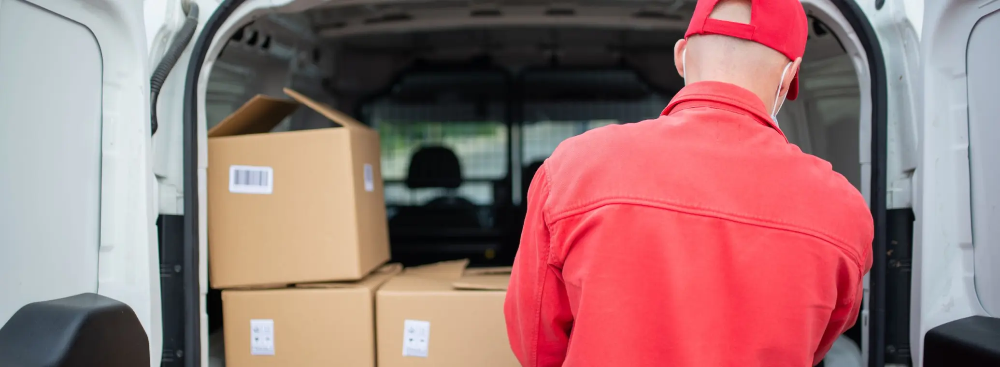

# China to Spain Fulfilment (2027): The €3 Duty, IOSS, Spain's Plastic Tax and Delivery Times

> **Quick answer:** Orders from China reach Spanish customers in about **6 to 14 days** on our standard service. Every low-value parcel now pays the EU's **€3 duty per item category** (since 1 July 2026) and a **€2 handling fee** (since 1 November 2026), on top of **21% Spanish VAT** for most goods. Collect the VAT at checkout through **IOSS**, ship **DDP** so nothing is charged at the door, check whether **Spain's plastic packaging tax** applies to you, and treat the **Canary Islands, Ceuta and Melilla** as separate destinations.

Spain is one of the EU's largest online markets, and Spanish shoppers are used to buying from China. What changed in 2026 is the cost and the paperwork. Every parcel from outside the EU now pays a fee, and parcels with wrong VAT data are the ones that get held.

This page covers what a D2C brand shipping from China to Spain needs to know for 2027: the charges, VAT, packaging rules, the islands, and delivery times.

## What each parcel pays

| Charge | Since | Amount | Notes |
|---|---|---|---|
| EU customs duty on low-value parcels | 1 July 2026 | **€3 per item category** | Temporary, until 1 July 2028 |
| EU customs handling fee | 1 November 2026 | **€2**, initially | Not refunded; basis to confirm with your carrier |
| Spanish VAT (IVA) | Always | **21%** for most goods | Lower rates apply to some goods |

**The €3 duty.** Since **1 July 2026**, the EU has charged a temporary flat duty of **€3** on low-value e-commerce consignments, under Council Regulation (EU) 2026/382. It replaces the old duty exemption for goods under €150 and runs until **1 July 2028**, when normal tariffs take over. Correos, Spain's postal operator, applies it to every import declaration it handles and states that it is separate from VAT, so a customer who paid VAT through IOSS still owes it unless the seller has paid it.

**The €2 handling fee.** Since **1 November 2026**, an EU customs handling fee, initially set at **€2**, has applied to low-value e-commerce imports. It is separate from the €3 duty. Published guidance differs on whether it is counted per item category or per customs declaration line, so confirm how your carrier charges it.

**Ship DDP.** If the parcel ships DAP, Correos or the courier collects these charges from your customer before delivery, often with a handling charge on top. Ship DDP and they are paid before the parcel arrives. Our [DDP explainer](/ddp-shipping-from-china-explained-2026.html) covers how it works, and our [EU de minimis guide](/eu-de-minimis-2026-customs-duty-guide.html) covers the EU rules in detail.

## Spanish VAT and IOSS

For consignments of **€150 or less**, you can charge Spanish VAT at checkout and pay it through the EU's **Import One-Stop Shop (IOSS)** in one monthly return. The standard rate in Spain is **21%**. With IOSS, the parcel clears without VAT being charged again at the border.

A seller **established outside the EU must appoint an EU-established intermediary** to register for IOSS. Arrange it with a VAT adviser well before you launch.

For consignments **over €150**, IOSS does not apply. VAT and normal duty are charged on import.

Registering for IOSS and VAT is the seller's responsibility, done with a tax adviser.

## Spain's plastic packaging tax

Spain has its own tax on packaging, on top of the EU charges.

- **What it is.** The *impuesto especial sobre los envases de plástico no reutilizables*, a special tax on non-reusable plastic packaging, in force since **1 January 2023** under Law 7/2022.
- **The rate.** **€0.45 per kilogram** of non-recycled plastic.
- **Who it reaches.** It covers the manufacture, purchase from other EU countries and import of non-reusable plastic packaging, including packaging that wraps imported goods. The Spanish tax agency's guidance says importers not established in Spain must appoint a representative.

How it applies to small D2C parcels depends on who imports them and how they clear, so ask a Spanish tax adviser before you start shipping. Paper mailers and cardboard boxes contain no plastic for this tax, which is one reason to choose them for Spain.

**Packaging EPR.** Separately, sellers placing packaging on the Spanish market fall under Spain's packaging producer responsibility rules, with Ecoembes as the main scheme for household packaging. Sellers without an establishment in Spain generally need an authorised representative. Our [EU packaging compliance guide](/epr-ppwr-eu-packaging-compliance-2026.html) covers the rules country by country.

## The Canary Islands, Ceuta and Melilla

The **Canary Islands, Ceuta and Melilla** are part of Spain but outside the EU VAT area. EU VAT and IOSS do not apply there.

- **The Canary Islands** have their own indirect tax, **IGIC**.
- **Ceuta and Melilla** have **IPSI**.

Set them up as separate destinations in your store, with their own tax handling and delivery times. A checkout that charges 21% IVA on a Canary Islands order has charged the wrong tax.

## Delivery from Shenzhen

Our standard delivery time from our Shenzhen warehouse to customers in the EU, including mainland Spain and the Balearic Islands, is **6 to 14 days**. Express couriers are faster where you need it. Shipping costs are quoted per shipment.

**Three Kings' Day.** In Spain, the main gift day of the season is **6 January**, Día de Reyes, not 25 December. If you sell gifts to Spain, plan a separate dispatch date for Reyes and [contact us](Contact-Us.html) for the exact cut-off for your service.

**Bulk stock.** If your Spanish sales grow large, holding some stock in Spain or elsewhere in the EU can make sense for bestsellers. Sea freight from China to Valencia or Barcelona takes several weeks port to port. Our [hybrid model guide](/china-us-hybrid-fulfillment-model-2026.html) explains how to split stock between China and a destination warehouse.

## Selling on Spanish marketplaces

Many brands selling to Spain use **Amazon.es**. If you sell there, our [Amazon FBA prep](/amazon-fba-prep-china.html) service prepares and ships stock to Amazon's warehouses.

**Miravia**, Alibaba's Spanish marketplace, is aimed at Spain and Portugal. Integration guides report that it accepts sellers with a legal entity in Spain or certain other European countries, so check its current eligibility rules before you plan around it.

## Your Spain checklist

1. **Register for IOSS** through an EU intermediary, and charge 21% VAT at checkout on orders of €150 or less.
2. **Ship DDP** so the €3 duty and €2 fee are paid before delivery.
3. **Check every SKU's customs data**: a clear description, HTS code and value.
4. **Ask a Spanish tax adviser about the plastic packaging tax**, and prefer paper and cardboard packaging.
5. **Check your packaging EPR obligations** in Spain.
6. **Set up the Canary Islands, Ceuta and Melilla** as separate destinations.
7. **Plan a Reyes cut-off** for 6 January as well as Christmas.

## Where we sit in this

We pick, pack and ship D2C orders from our warehouse in Shenzhen to Spain and the rest of the EU, DDP, in your own packaging. Pick and pack is **$0.99 per order** with standard packaging included, receiving is free and there are no setup fees or minimums. New customers get **30 days' free storage** when their first order ships within those 30 days. VAT, IOSS registration, the plastic packaging tax and EPR registration are the seller's responsibility, done with a qualified adviser.

## The bottom line

Spain is still an easy market to ship to from China, but not a free one. Every parcel pays the €3 duty and the €2 fee, VAT has to be collected at checkout, Spain taxes plastic packaging, and the islands sit outside the EU VAT area. Ship DDP with IOSS, choose paper packaging, and give your Spanish customers an honest 6 to 14 day delivery promise.

[Tell us about your Spanish orders](Contact-Us.html) and we will quote your shipping.

Rules as at 26 November 2026. **Sources:** [European Commission on the €3 duty](https://commission.europa.eu/news-and-media/news/ensuring-fairness-and-safety-eur3-customs-duty-low-value-parcels-2026-06-29_en); [Correos on the low-value parcel duty](https://www.correos.es/es/es/atencion-al-cliente/informacion-aduanera/arancel-para-envios-de-bajo-valor-en-la-ue); [Garrigues on the handling fee from 1 November 2026](https://www.garrigues.com/es_ES/noticia/union-europea-1-noviembre-2026-comienza-aplicacion-tasa-gestion-comercio-electronico); [Agencia Tributaria on the plastic packaging tax](https://sede.agenciatributaria.gob.es/Sede/en_gb/impuestos-especiales-medioambientales/impuesto-especial-sobre-envases-plastico-reutilizables.html); [Landmark Global on the tax for importers](https://landmarkglobal.com/eu/es/noticias/envases-de-plastico/); [ChannelEngine on Miravia](https://support.channelengine.com/hc/en-us/articles/10531820865181). Tax questions belong with a qualified adviser in Spain.
