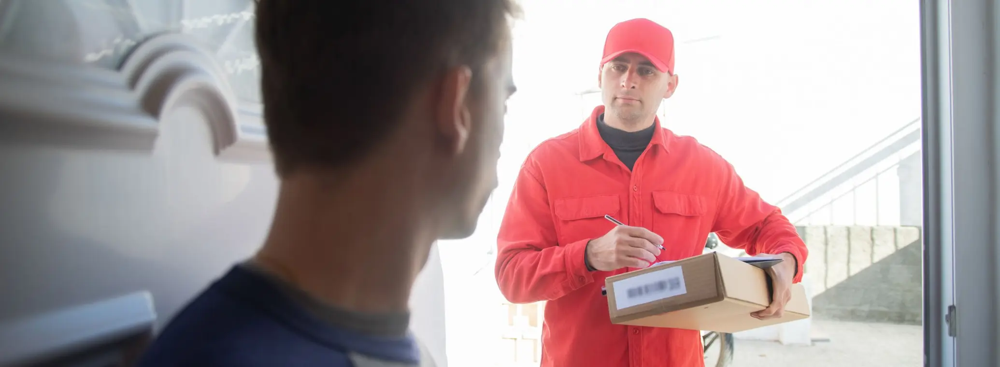

# China to US Fulfillment for D2C Brands in 2027: Delivery Times, Duty and DDP

> **Quick answer:** You can fulfil US orders straight from a warehouse in China. Our standard delivery time from Shenzhen to US customers is **6 to 10 days**. Since the $800 de minimis exemption was suspended, **every parcel pays US duty**, and the exemption is repealed in law from **1 July 2027**. Ship **DDP** so the duty is paid before delivery and your customer never sees a bill, classify every product correctly, and price the duty in. For heavy bestsellers, bulk import to a US warehouse can be cheaper, so many brands split the catalogue.

The US is the largest market most D2C brands sell into, and for brands whose products are made in China it is also the one where the rules moved most in the last eighteen months. Duty-free parcels ended, the IEEPA tariffs came and went, and a new forced labor duty arrived.

None of that stops you shipping to US customers from China. It changes what each parcel costs and what you need to get right. This page sets out how China to US fulfillment works in 2027, what it costs, and when it is the right setup.

## How it works

1. **Your stock lands in our Shenzhen warehouse.** We count it against your purchase order and inspect it on arrival.
2. **Your store sends us the orders.** Shopify, WooCommerce and other platforms connect, so orders flow in without exports.
3. **We pick and pack each order**, in your branded packaging if you supply it, at the same rate.
4. **The parcel ships DDP to your customer.** The duty is settled before delivery and tracking goes back to your store.

The whole process sits on one idea: your customer should experience a US order, not an import.

## Delivery times from China to the US

| Service | Typical delivery time | Best for |
|---|---|---|
| Our standard D2C service, DDP | **6–10 days** | Most D2C orders |
| Express courier (DHL, FedEx, UPS) | 3–5 business days | Urgent, high-value or premium orders |
| Bulk air freight to a US warehouse | 5–10 days | Restocking a US 3PL or Amazon |
| Sea freight to a US warehouse | 14–16 days to the West Coast port, plus clearance and inland delivery | Heavy bestsellers in volume |

Express and bulk times are from our [shipping times and costs guide](news-shipping-times-costs-china-2026.html). Peak season and customs checks can add days, so set the delivery promise on your store a little longer than the typical time. Our post on [shipping from China to the USA](shipping-from-china-to-usa-d2c-2027.html) goes through every method in detail.

## What each parcel pays in duty

This is the part that changed. Until 2025, most D2C parcels under $800 entered the US duty-free under de minimis. That exemption is now suspended for goods from every country, and Congress has repealed it in law from 1 July 2027. Our post on [whether de minimis is coming back](shipping-d2c-orders-china-to-us-2027.html) explains why it is not.

So every parcel from China pays up to three layers of duty:

1. **The normal MFN duty** for the product's HTS code
2. **Any Section 301 list duty**, from 7.5% to 100% depending on the list
3. **The 12.5% Section 301 forced labor duty**, in force since 24 July 2026, unless the product is exempt

The IEEPA tariffs that applied for most of 2025 stopped on 24 February 2026, and duty paid under them is being refunded to importers of record. Our [IEEPA refund guide](ieepa-tariff-refunds-china-sellers-2026.html) covers who gets that money.

From **20 January 2027**, China-origin parcels sent by post must use CBP's new Entry Type 13 or a formal entry. Express courier parcels are not affected by that change.

## Why DDP is the standard for US orders

Under **DAP**, the carrier asks your customer to pay the duty, usually with a handling fee on top, before it hands the parcel over. A customer who has already paid you is unlikely to pay again happily. Some refuse the parcel, some file a chargeback, and most do not buy again.

Under **DDP**, the duty is paid before delivery, so the parcel arrives like any domestic order. You know the full landed cost of every order in advance and can price it in. Say "duties included" on your product pages and at checkout so customers know there is nothing to pay at the door. Our [DDP explainer](ddp-shipping-from-china-explained-2026.html) covers how it works from Shenzhen.

One thing DDP does not change: the legal obligations of the importer stay with you, the seller. We ship DDP and keep the customs data consistent, but we are not your importer of record or your customs broker.

## A worked cost example

Here is a single order for a product your customer pays **$40** for, with a 5% MFN duty rate, on Section 301 List 4A at 7.5%, and subject to the 12.5% forced labor duty. That is a combined duty rate of 25%. For a sale direct to a consumer, the declared value is usually the price the customer paid.

| Line | Cost |
|---|---|
| Pick and pack, standard mailer included | **$0.99** |
| US duty at 25% of the $40 declared value | **$10.00** |
| Shipping to the customer | Quoted by weight, size and service |
| Carrier clearance or disbursement charge, if any | Set by the carrier |

Two things stand out. Our handling is the smallest line on the order. And the duty is now the second largest cost after shipping, which is why it has to be in your price rather than treated as a surprise. Your own duty rate depends on the HTS code, so check it for every product before you set prices. Our [guide to HTS classification mistakes](hts-classification-mistakes-importers-2026.html) shows where sellers go wrong.

## Ship direct from China, or hold stock in the US?

Both work, and the answer is usually both, split by product.

**The duty base is the big difference.** Shipped direct, duty is charged on each parcel's retail value. Imported in bulk, it is charged once on the wholesale value. On the $40 product above, if it cost you $10 from the factory, duty is $10.00 per unit shipped direct from China and $2.50 per unit imported in bulk at the same 25% rate.

Bulk import brings its own costs: freight, a US warehouse and its fees, and buying stock months earlier. Our [D2C vs US 3PL cost audit](direct-from-china-d2c-vs-us-3pl-2026.html) works through them.

| Ship direct from China | Bulk import and fulfil in the US |
|---|---|
| Light, higher-margin products | Heavy, low-margin bestsellers |
| Wide catalogues where most SKUs sell slowly | A few SKUs that sell every week |
| New products you are testing | Products customers expect in two days |
| Crowdfunding rewards and pre-orders | Retail and wholesale replenishment |

That split is the [hybrid model](china-us-hybrid-fulfillment-model-2026.html): bestsellers in a US warehouse, the long tail shipped direct from China. We can run both sides from Shenzhen, shipping D2C orders and consolidating bulk stock for your US warehouse or for [Amazon FBA](amazon-fba-consolidation.html).

## Your setup checklist

1. **Confirm the HTS code and duty rate for every product**, including the 12.5% forced labor duty.
2. **Ship DDP** and say "duties included" at checkout.
3. **Price the duty in** per product, not as one blanket margin.
4. **Set your delivery promise** a little longer than the typical time, and longer again in December.
5. **Keep product data consistent**: description, value, HTS code and country of origin should match from invoice to parcel.
6. **Split the catalogue** if some products are heavy, low-margin bestsellers.
7. **Check whether you paid IEEPA duty in 2025** and whether you are owed a refund.

## Where we sit in this

We pick, pack and ship D2C orders from our Shenzhen warehouse to US customers, DDP, with a standard delivery time of **6 to 10 days**. Pick and pack is **$0.99 per order** with standard mailers and small boxes included, storage is **$0.49 per CBM per day**, and receiving is free. There are no setup fees or minimum volumes, and new customers get 30 days free storage when their first order ships within those 30 days.

We work best for brands shipping 300 or more orders a month, though there are no minimums. Customs decisions about your products belong with you and a licensed customs broker.

## The bottom line

Fulfilling US orders from China works in 2027, but not the way it did in 2024. Every parcel pays duty, so ship DDP, get every HTS code right, and put the duty in the price. Ship the light, varied and new products direct from Shenzhen in 6 to 10 days, and look hard at bulk import for your heaviest bestsellers.

[Send us your top products and monthly orders](Contact-Us.html) and we will show you what each one costs to deliver to a US customer, duty included.

This is general information as at 8 November 2026, not legal or customs advice. Duty depends on your HTS codes, and parts of the US rules are still changing, so confirm your position with a licensed customs broker.
