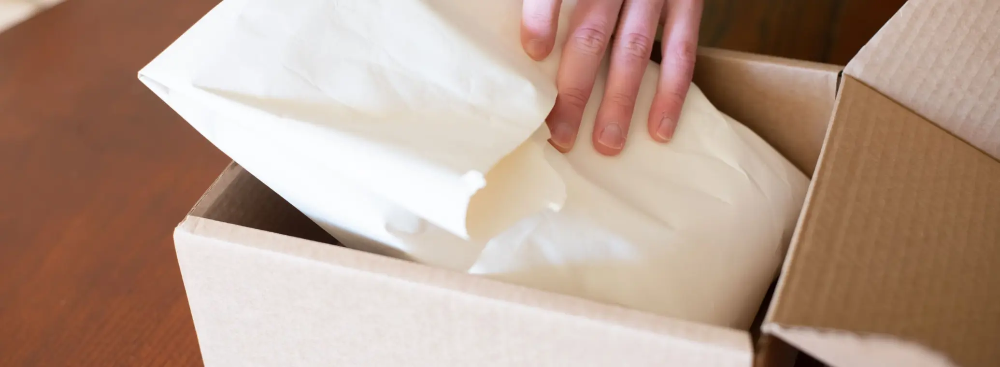

# From Dropshipping to a Branded D2C Store: A Step-by-Step Plan for 2027

> **Quick answer:** Keep the two or three products that sell steadily and drop the rest. Buy them from a factory to your own spec, give the business a name you can protect, and pack every order in your own packaging. Check the compliance and labelling rules for your markets, set an honest delivery promise, ship DDP so customers never pay duty at the door, and move fulfilment to a warehouse that holds your stock. Do it one product at a time.

A dropshipping store sells products. A brand sells a reason to buy from you again. The difference is not a logo. It is that a customer gets the same product, in the same packaging, on the date you promised, every time.

That is hard to deliver when someone else owns the stock. This is a step-by-step plan for making the move.

## Step 1: Choose the products to keep

Look at the last 90 days and find the products that sold steadily, had good reviews and made a margin after ads and refunds. Most stores find that two or three products carry the business.

Those are your brand. Everything else either stays on dropshipping while you test, or goes. A focused range is easier to buy, stock, photograph and explain.

## Step 2: Own the product

Dropshipping customers get whatever the supplier has that day. A brand needs one product, made the same way every time.

1. **Find the factory.** Your supplier or agent may introduce you, or you can source directly.
2. **Order samples** and compare them with what your customers have been receiving. Look at the reviews for complaints you can fix.
3. **Write a short spec**: materials, colours, sizes, tolerances and what counts as a defect.
4. **Agree the minimum order quantity** and lead time.
5. **Plan the first inspection.** Every delivery to us is counted against the purchase order and visually inspected on arrival, and deeper checks can be arranged. Our post on [quality control at the source](news-quality-control-china-supplier.html) covers the options.

Small changes, a better material or a colour no one else sells, are often enough to make the product yours.

## Step 3: Own the name

Choose a name you can use across your store, social channels and packaging, and check it is not already in use in your markets. Before you invest heavily in it, ask a trademark attorney about protecting it where you sell. If you plan to sell on Amazon, its brand protection programme is tied to a trademark, so check Amazon's current eligibility rules.

## Step 4: Design the packaging

Packaging is the first physical thing a customer sees from you, and on a dropshipped order it is usually a plain grey bag.

Start simple:

- **A branded mailer or box**, sized to the product so you are not paying to ship air
- **An insert card** with a thank-you, care instructions or a discount for the next order
- **Tissue or a sticker** if the product suits it

We pack in your branded materials at the standard **$0.99 per order** pick and pack rate, with no surcharge. Kitting, bundles and gift sets are priced per unit. Our [branded packaging and kitting](branded-packaging-kitting.html) page shows the options, and our [dimensional weight guide](dim-weight-packaging-optimisation-2026.html) explains why box size matters for shipping cost.

## Step 5: Check compliance and labels

Owning the product means owning its compliance. Depending on the product and market, that can include safety testing, labelling, country of origin marking and battery or chemical rules. These are the seller's and manufacturer's responsibility, not the fulfilment provider's.

Our guide to [product compliance when importing from China](product-compliance-importing-from-china-2026.html) covers the main rules for the US, UK and EU, and our post on [shipping batteries and electronics](shipping-batteries-electronics-from-china-2026.html) covers the extra steps for those products.

## Step 6: Set an honest delivery promise

Nothing loses repeat customers faster than a missed delivery date. Shipping from our Shenzhen warehouse, our standard delivery times are **6 to 10 days to the US, 5 to 8 days to the UK and 6 to 14 days to the EU**, with express faster where you need it.

Put a realistic range on your product pages, a little longer than the typical time, and longer again in December. A brand that says "delivered in 7 to 12 days" and arrives on day 8 wins more trust than one that says "fast shipping" and arrives on day 15.

## Step 7: Price the duty in and ship DDP

Since the US de minimis exemption was suspended, every parcel from China to a US customer pays duty, and the exemption is repealed in law from 1 July 2027. Other markets have their own rules, such as the UK's £135 VAT line and the EU's €3 duty per item category.

Ship **DDP**, so the duty is paid before delivery and the customer never sees a bill at the door, and build the duty into each product's price. Our [DDP explainer](ddp-shipping-from-china-explained-2026.html) covers how it works, and our post on [shipping D2C orders to the US in 2027](shipping-d2c-orders-china-to-us-2027.html) shows what each US parcel pays.

## Step 8: Move fulfilment to your own stock

With the product, name and packaging ready, ship the first batch to a warehouse that holds your stock and packs your orders.

1. **Order a small first batch**: a few weeks of sales, within the factory's minimum.
2. **Ship it to the 3PL**, where it is counted and inspected on arrival.
3. **Connect your store** and route the branded products to the 3PL. Keep dropshipping anything still in testing.
4. **Watch the first month closely**: reviews, refunds, delivery times and repeat orders.

Our post on [when to switch from dropshipping to a China 3PL](switch-from-dropshipping-to-china-3pl.html) covers the signs that you are ready, and our comparison of [AliExpress or CJ dropshipping with your own stock](aliexpress-cj-dropshipping-vs-own-stock-china-warehouse.html) covers the options in between.

## Step 9: Plan for the next market

Once the brand works in one market, the same stock in China can serve others. Our market guides cover the [UK](china-to-uk-fulfilment-shopify.html), [Canada](china-to-canada-fulfillment-2026.html), [Australia](china-to-australia-fulfillment-2026.html) and [Germany and the EU](china-to-germany-fulfillment-2026.html), and our [China to US fulfillment page](china-to-us-fulfillment-2027.html) covers the US. When a product sells heavily in one market, moving bulk stock into a warehouse there can make sense, which is the [hybrid model](china-us-hybrid-fulfillment-model-2026.html).

## Where we sit in this

We hold stock for D2C brands in our Shenzhen warehouse, inspect it on arrival and pack each order in your branded packaging, with DDP to the main markets. Pick and pack is **$0.99 per order** with standard packaging included, receiving is free and there are no setup fees or minimums. New customers get 30 days free storage when their first order ships within those 30 days.

## The bottom line

The move from dropshipping to a brand is a sequence, not a leap: keep your best products, own the product and the name, pack every order like it matters, get compliance and duty right, and promise only the delivery you can keep. Then move fulfilment to stock you own, one product at a time.

[Tell us about your bestsellers](Contact-Us.html) and we will help you plan the first branded batch.

Prices and rules as at 8 November 2026. Compliance, trademark and tax questions belong with a qualified adviser in your market.
