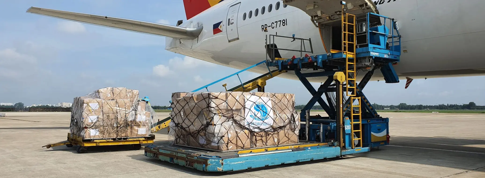

# ShipBob Alternatives for International Brands (2027): Who Fits When Your Products Are Made in China

> **Quick answer:** ShipBob fulfils from the US, Canada, the UK, the Netherlands, Spain and Australia, and has no warehouse in China. The right alternative depends on where your stock starts and where your customers are. **ShipMonk** is a US-based alternative with cross-border DDP. **byrd** fulfils from 12 centres in the EU and UK. **NextSmartShip** pairs China with warehouses in 12 other countries. **ChinaDivision, SendFromChina and us** ship each order direct from China, where the products are made. **Easyship** is shipping software with a fulfillment network. Many international brands use two providers, not one.

ShipBob is one of the best-known names in ecommerce fulfillment, and for a brand with stock in the US and customers in its network, it is a strong option. People look for alternatives for international reasons: their products are made in China, their customers are spread across countries outside the network, or they want a specialist in one region.

This comparison is for those brands. We are one of the providers in it, so we have used each company's own published claims and spelled out where the others fit better than we do.

## What ShipBob covers, as it states it

As at 8 November 2026, ShipBob's locations page says it ships from "50+ global locations", with fulfillment centers in **the US, Canada, the UK, the Netherlands, Spain and Australia**. China is listed as a destination, not a fulfillment location. Its pricing page lists standard fee types, including implementation, receiving, storage and pick, pack and ship, and says "All quotes are customized for each customer."

So with ShipBob, stock made in China is shipped in bulk to one of those countries first, and orders are fulfilled from there.

## The alternatives, by where they fulfil from

Every figure below is what the company states about itself on its own website, as at 8 November 2026. We have not audited any of them, including ourselves.

| Provider | Fulfils from | As the company states it |
|---|---|---|
| **ShipMonk** | United States | "12+ fulfillment centers on 7 campuses", US sites in Nevada, Texas, Kentucky and Pennsylvania, "4,400+ brands", "Hassle-free global shipping with DDP" |
| **byrd** | EU and UK | "12 fulfillment centers in the EU & UK", in Austria, France, Germany, the UK and Poland |
| **NextSmartShip** | China plus 12 other countries | "20+ warehouses" across 13 countries including China, the US, Germany, the UK, Japan, Canada and Australia; handling "$0.5 first pick, $0.1 / additional pick per order" |
| **ChinaDivision** | China | Shenzhen, 20,000 m²+, "8,000+ brands", ISO 9001:2015, ships to "200+ Countries & Regions", pick and pack "From $0.59 / order" |
| **SendFromChina (SFC)** | China | Over 40,000 m³ of storage, parent listed on ChiNext, ships to "220+ countries and regions" |
| **Easyship** | Shipping software with a fulfillment network | "550+ Courier Services", shipping rates, labels and duty calculation, plus a global fulfillment network |
| **China Fulfillment International** | China | Shenzhen, established 2010, 250,000 sq ft, ships to 200+ countries, pick and pack $0.99 per order |

## Which kind of alternative fits you

**Your stock is in the US and you want another US 3PL.** ShipMonk is the closest like-for-like alternative in this list. Its site also mentions Section 321, the US de minimis route, which is suspended for every country and repealed in law from 1 July 2027, so ask how its cross-border service works now.

**Most of your customers are in Europe.** byrd specialises in EU and UK fulfillment. Holding stock inside the EU and the UK gives domestic delivery speed in both, at the cost of importing into each.

**You want one provider across many countries, starting in China.** NextSmartShip states the widest network here, with China and 12 other countries.

**Your products are made in China and your customers are everywhere.** A China 3PL ships each order direct from where it was made, to any country, without bulk freight or a second warehouse. ChinaDivision, SendFromChina and we all work this way.

**You want to keep control of shipping and choose couriers yourself.** Easyship is software first, with rates from hundreds of courier services.

## Where the others beat us

**For two-day delivery in the US or the EU, a local 3PL wins.** We ship from China: our standard delivery times are 6 to 10 days to the US, 5 to 8 days to the UK and 6 to 14 days to the EU. If speed drives your conversion on a product, hold it locally. We can consolidate and ship the bulk stock to that warehouse.

**On the headline pick and pack rate, two China 3PLs are cheaper.** As at 8 November 2026, ChinaDivision lists pick and pack "From $0.59 / order" and NextSmartShip lists "$0.5 first pick, $0.1 / additional pick per order". Ours is $0.99 per order with standard packaging included. Compare the whole order, but on handling alone they quote lower.

**For one provider in many countries, NextSmartShip has the network.** We fulfil from China only and work alongside a separate local warehouse where you need one.

**If ISO 9001 is a requirement, ChinaDivision states it holds ISO 9001:2015.** We do not.

**If you want a listed company, SFC's parent is listed.** We are private.

## Where we are genuinely different

**One published price list, storage included.** Pick and pack **$0.99 per order** with standard packaging included, storage **$0.49 per CBM per day**, free receiving, no setup fees and no minimums. As at 8 November 2026, ChinaDivision and NextSmartShip publish their pick and pack rates but not a storage rate, so with us you can price a whole order, storage included, up front.

**Branded packaging at no extra cost.** We pack in your own boxes, mailers and inserts at the same rate.

**On the ground with your suppliers.** Our team works in Mandarin with your factories, inspects every delivery on arrival and chases short or wrong shipments in person. See our [supplier management](supplier-management-china.html).

**DDP to the main markets.** Duty is paid before delivery, so customers in the US, UK, EU, Canada and Australia are not asked to pay at the door.

## Two providers is often the answer

For international brands with products made in China, the strongest setup is often two providers: a China 3PL that ships the long tail and new products direct to every market, and consolidates bulk stock for a local 3PL that holds the bestsellers in your biggest market. That is the [hybrid model](china-us-hybrid-fulfillment-model-2026.html). Our comparison of [Shopify fulfillment for brands sourcing from China](best-shopify-fulfillment-brands-sourcing-from-china-2027.html) and our honest look at [the best China 3PLs](best-china-3pl-companies-2026.html) cover each side.

## How to choose

1. **Where is your stock made?** If it is China, ask whether you need to move it at all before an order comes in.
2. **Where are your customers, and how fast do they expect delivery?**
3. **How many countries do you sell into?** The more countries, the more a ship-from-origin model saves on warehouses.
4. **How much work does each order need?** Kitting, inserts and inspection are cheaper at the source.
5. **What does the whole order cost?** Handling, storage, packaging, shipping and duty together, not just pick and pack.

Then run a pilot with a small batch before you move everything.

## Where we sit in this, and where we do not

We are one of the providers in this comparison, and we wrote it. We have used each company's own published claims and been plain about where the others are a better fit, but read it knowing who wrote it and check anything important directly with each provider. We have not included every alternative to ShipBob; we have kept to the ones most relevant to brands selling internationally with products made in China.

## The bottom line

The best ShipBob alternative for an international brand depends on two things: where the stock starts and where the customers are. Stay in-market with ShipMonk in the US or byrd in Europe, go wide with NextSmartShip, or ship from the source with a China 3PL. For many brands the answer is a China 3PL plus one local warehouse.

If shipping from China is the side you need, [get a quote](Contact-Us.html). If a local 3PL fits you better, we would rather tell you now.

Company details are as each provider states them on its own website at 8 November 2026. Services and figures change, so confirm them with the provider before you decide.
