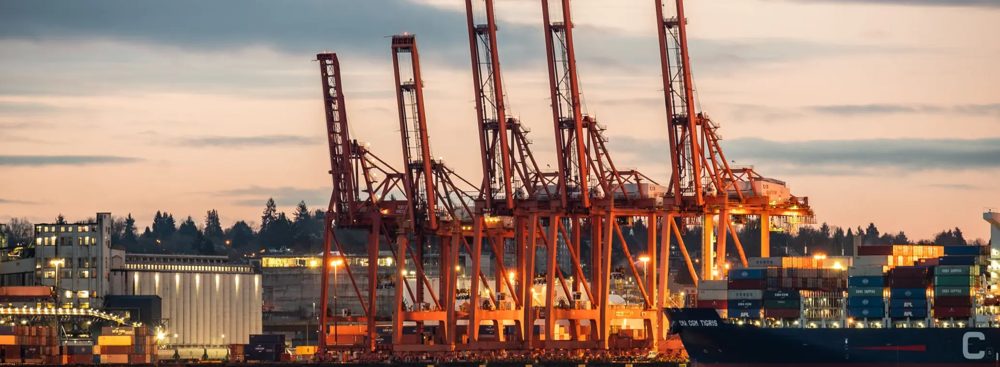

# Shipping from China to Canada in 2027: Delivery Times, Costs, Duty and GST

> **Quick answer:** A D2C parcel from China to Canada takes **9 to 12 days on our standard service** and about **5 to 9 days by express**. Bulk stock takes roughly **6 to 12 days by air** plus clearance and **20 to 35 days by sea**. Goods from China are duty and tax free only up to **CAD$20**, so almost every order pays **GST or HST** and often duty. Ship **DDP** so your customer pays nothing at the door.

Canada is a natural second market for brands already selling to the US. But Canada treats goods from China differently from goods shipped from the US, and the difference shows up on almost every parcel.

This post covers every way to ship from China to Canada, how long each takes, what drives the cost, and the tax rules for 2027.

## Delivery times, by method

| Method | Typical time to Canada | Used for |
|---|---|---|
| Our standard D2C service, DDP | 9–12 days | Most D2C orders |
| Express courier (DHL, FedEx, UPS) | About 5–9 days door to door | Urgent or high-value orders |
| Air freight, bulk | Roughly 6–12 days plus clearance | Restocking a Canadian warehouse or Amazon.ca |
| Sea freight, bulk | Around 20–35 days | Large volumes of stock |

West Coast destinations near the Pacific ports usually clear and deliver faster than the east. Set the delivery promise on your store a little longer than these figures, and longer again in December.

## What shipping costs

For a D2C parcel, the price comes down to four things:

1. **Chargeable weight**, the higher of the actual weight and the volume weight. Our [dimensional weight guide](dim-weight-packaging-optimisation-2026.html) shows how packing tighter cuts it.
2. **The service.** Express costs most and arrives fastest.
3. **Surcharges** for fuel and peak season, which carriers publish on their own websites.
4. **Duty and tax**, below, and any carrier clearance charge.

Rates to Canada move with fuel, season and volume, so we quote every shipment on your actual products rather than publish a per-kilogram figure.

## What each parcel pays in Canada

**The CAD$20 threshold.** Courier shipments from countries other than the US and Mexico, which includes China, are free of duty and tax only up to **CAD$20**. That is a very low bar, so plan as if every order pays.

**The CUSMA thresholds do not apply.** You may have read that shipments up to CAD$40 are tax free and up to CAD$150 duty free. Those thresholds apply only to goods from the **US and Mexico** under the CUSMA trade agreement. Goods from China do not get them, even if your competitors' stock ships from a US warehouse.

**Above CAD$20**, the parcel pays:

- **GST at 5%**, or **HST** in the provinces that combine federal and provincial sales tax
- **Provincial sales tax** in some other provinces
- **Customs duty** at the rate for the product's tariff classification

**Splitting doesn't help.** Guidance on the Canadian rules says the threshold applies to the whole shipment, not each box, so splitting an order into several parcels does not keep it under CAD$20.

**Ship DDP.** Under DAP, the courier collects duty and tax from your customer at the door, usually with its own handling fee. On a market where most parcels owe something, that means refused deliveries and complaints on a large share of orders. Under DDP everything is paid before delivery. Our [DDP explainer](ddp-shipping-from-china-explained-2026.html) covers how it works.

## Bulk stock and CARM

If you import bulk stock into a Canadian warehouse or Amazon.ca, you are the importer, and the importer must be registered on **CARM**, the Canada Border Services Agency's accounting system, which has been mandatory since October 2024. You need a Business Number and an import-export account, and a licensed customs broker can act for you. Our [China to Canada fulfilment page](china-to-canada-fulfillment-2026.html) covers CARM in more detail.

## Postal disruption

Canada Post had a national strike in late 2024 and rotating strikes in 2025, and during the 2024 strike it held international items it had received until service resumed. If you ship to Canada, use a courier service with a street address rather than a post office box wherever you can, so parcels are less exposed if the postal network stops again.

## Direct from China, or stock in Canada?

**Ship direct** while you are testing Canada: no Canadian importer setup of your own, no second warehouse, and a 9 to 12 day delivery promise.

**Add stock in Canada** for heavy bestsellers once sales are steady. Bulk import pays duty on the wholesale value rather than on each parcel's retail value, and customers get domestic delivery times. That is the [hybrid model](china-us-hybrid-fulfillment-model-2026.html) applied to Canada.

## Five ways to cut the cost per order

1. **Pack tight.** Dimensional weight is the most common avoidable cost on D2C parcels.
2. **Price the tax in.** Show Canadian prices that already include GST or HST and duty, so the checkout total is the final total.
3. **Get the tariff classification right.** A wrong code means the wrong duty on every parcel.
4. **Use express for premium items only.** Standard DDP is enough for most orders.
5. **Move heavy bestsellers in bulk** once a product proves itself.

## Where we sit in this

We ship D2C orders from our Shenzhen warehouse to Canadian customers, DDP, with a standard delivery time of **9 to 12 days**, and by express when you need it faster. Pick and pack is **$0.99 per order** with standard packaging included, receiving is free and there are no setup fees or minimums. New customers get **30 days' free storage** when their first order ships within those 30 days. For brands with Canadian stock, we consolidate and forward bulk shipments by air and sea.

## The bottom line

Shipping from China to Canada takes 9 to 12 days on a standard DDP service and about 5 to 9 days by express. Goods from China lose their duty and tax exemption at just CAD$20, so price GST, HST and duty into your Canadian prices and ship DDP. When a product sells steadily, bring it in by sea and ship it from Canada.

[Send us your product sizes and weights](Contact-Us.html) and we will quote the delivered cost to your Canadian customers.

Rules as at 26 November 2026. **Sources:** [Gaia Dynamics on Canada's low-value thresholds](https://www.gaiadynamics.ai/blog/canada-still-has-de-minimis-clvs-thresholds-for-cross-border-e-commerce-after-the-us-suspension); [CanFlow Global on Canadian parcel clearance](https://www.canflow-global.com/en/insights/canada-us-border-customs-after-de-minimis-what-changed-for-parcel-clearance/); [EMS on international items during the 2024 Canada Post strike](https://ems.post/en/node/2829); [FreightWaves on the 2025 rotating strikes](https://www.freightwaves.com/news/canada-post-workers-to-resume-mail-delivery-switch-to-rotating-strikes). This is general information, not customs or tax advice. Confirm your obligations with a Canadian customs broker.
