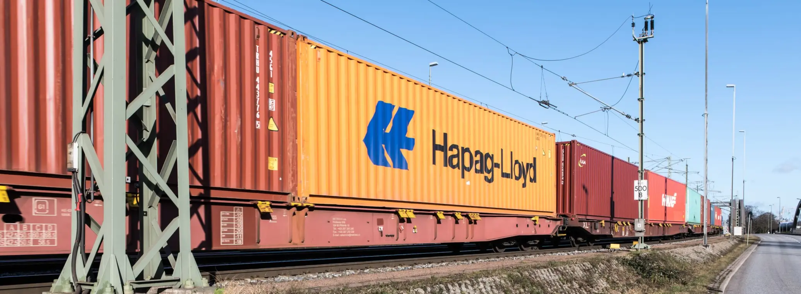

# Shipping from China to Germany in 2027: Delivery Times, Costs and the New EU Fees

> **Quick answer:** A D2C parcel from China to Germany takes about **3 to 5 days by express** and **6 to 14 days on our standard DDP service**. Bulk stock takes about **4 to 7 days by air**, **12 to 20 days by truck**, **14 to 25 days by rail** and **30 to 45 days or more by sea**. Every low-value parcel now pays the EU's **€3 duty per item category** and a **€2 handling fee**, plus **19% German VAT** for most goods. Ship DDP with IOSS, and register in **LUCID** before your first parcel.

Germany is one of the most demanding e-commerce markets in Europe. German shoppers expect accurate delivery dates and no surprise charges, and German law expects every seller's packaging to be registered.

This post covers every way to get goods from China to Germany, how long each takes, what drives the cost, and what changed for 2027.

## Delivery times, by method

| Method | Typical time to Germany | Used for |
|---|---|---|
| Express courier (DHL, FedEx, UPS) | About 3–5 days door to door | Urgent or high-value orders |
| Our standard D2C service, DDP | 6–14 days to EU customers | Most D2C orders |
| Air freight, bulk | About 4–7 days | Restocking an EU warehouse or Amazon |
| Truck | About 12–20 days to Poland and Germany | Pallets and part loads |
| Rail | About 14–25 days terminal to terminal | Containers, faster than sea |
| Sea freight | About 30–45 days or more | Large volumes of stock |

Times are from our [shipping times and costs guide](news-shipping-times-costs-china-2026.html) and our [rail](china-europe-rail-freight.html) and [truck](china-europe-truck-freight.html) freight pages, except our standard service. They are typical, not guaranteed. Set the delivery promise on your store a little longer than these figures, because German customers notice a missed date.

## What shipping costs

For a D2C parcel, the price comes down to **chargeable weight** (the higher of actual and volume weight), **the service**, **surcharges** for fuel and peak season, and **duty, fees and VAT**. Our [dimensional weight guide](dim-weight-packaging-optimisation-2026.html) shows how packing tighter cuts the first.

As market references only, not quotes:

| Service | Reference rate | Source and date |
|---|---|---|
| Express courier to Europe | From about $9.20 per kg | Our shipping guide, early 2026 |
| Air freight, bulk | About $4.80 per kg | TAC Index, Hong Kong to Europe, September 2026 |
| Rail, 40ft container | About $10,000 | Index1520, August 2026 average |
| Sea, 40ft container | About $3,399 | Drewry WCI, Shanghai to Rotterdam, 1 October 2026 |
| Truck | Quoted per pallet | |

Rates move with fuel, season and capacity. We quote every shipment on your actual goods.

## What each parcel pays in the EU

Until mid-2026, parcels under €150 entered the EU free of duty. That has gone.

- **€3 customs duty per item category**, since **1 July 2026**, on low-value e-commerce consignments. It is temporary, until **1 July 2028**, when normal tariffs take over.
- **An EU customs handling fee**, initially **€2**, since **1 November 2026**. It is not refunded. Guidance differs on whether it is counted per item category or per declaration line, so confirm with your carrier.
- **German VAT**, **19%** for most goods (7% for some). For consignments of **€150 or less**, charge it at checkout and pay it through **IOSS**. A seller outside the EU needs an EU-established intermediary to register for IOSS.

**Ship DDP.** Under DDP all of these are paid before the parcel arrives. Under DAP the carrier collects them from your customer with a handling charge, and German customers refuse parcels with unexpected bills. Our [EU de minimis guide](eu-de-minimis-2026-customs-duty-guide.html) and [DDP explainer](ddp-shipping-from-china-explained-2026.html) cover the details.

## The packaging register: LUCID

Germany has a rule many sellers outside the EU miss. **Every seller whose packaged goods reach German consumers must register in LUCID**, the packaging register, and join a dual system that pays for recycling. There is no small-seller or foreign-seller exemption, and marketplaces can block listings without a valid LUCID number.

Since **12 August 2026**, Germany's new packaging law, the VerpackDG, also requires sellers with no establishment in Germany to appoint an **authorised representative** there. Our [China to Germany fulfilment page](china-to-germany-fulfillment-2026.html) and [EU packaging compliance guide](epr-ppwr-eu-packaging-compliance-2026.html) explain both.

## Direct from China, or stock in Germany?

**Ship direct** while you are testing the market or selling a wide range: no EU warehouse, no stock tied up in Germany, and a 6 to 14 day delivery promise.

**Add stock in Germany or nearby** for heavy bestsellers once sales are steady. Rail or truck brings it in two to three weeks, bulk import pays duty on the wholesale value rather than each parcel, and German customers get fast domestic delivery. That is the [hybrid model](china-us-hybrid-fulfillment-model-2026.html), and it works the same way for the EU as for the US.

## Five ways to cut the cost per order

1. **Pack tight.** Right-size every mailer and box.
2. **Choose the service per product.** Express for premium items, standard DDP for the rest.
3. **Get the customs data right.** A clear description, HS code and value on every parcel.
4. **Keep item categories down.** The €3 duty is counted per item category, so a parcel mixing many product types pays more.
5. **Move heavy bestsellers in bulk** by rail or truck.

## Where we sit in this

We ship D2C orders from our Shenzhen warehouse to Germany and the rest of the EU, DDP, with a standard delivery time of **6 to 14 days**, and by express when you need it faster. Pick and pack is **$0.99 per order** with standard packaging included, receiving is free and there are no setup fees or minimums. For brands with EU stock, we move bulk shipments by air, rail, truck and sea. LUCID registration, the authorised representative, VAT and IOSS registration are the seller's responsibility.

## The bottom line

Shipping from China to Germany takes 3 to 5 days by express and 6 to 14 days on a standard DDP service, and bulk stock arrives in about two to three weeks by rail or truck. Every parcel now pays the €3 duty, the €2 fee and German VAT, so ship DDP with IOSS, and register your packaging in LUCID before you start.

[Send us your product sizes and weights](Contact-Us.html) and we will quote the real delivered cost to your German customers.

Delivery times and reference rates as stated, rules as at 26 November 2026. **Sources:** [European Commission on the €3 duty](https://commission.europa.eu/news-and-media/news/ensuring-fairness-and-safety-eur3-customs-duty-low-value-parcels-2026-06-29_en); [Garrigues on the handling fee](https://www.garrigues.com/es_ES/noticia/union-europea-1-noviembre-2026-comienza-aplicacion-tasa-gestion-comercio-electronico); [ZSVR LUCID register](https://lucid.verpackungsregister.org/); [verpackungsgesetz.com on the authorised representative](https://www.verpackungsgesetz.com/en/bevollmaechtigtenzwang-auslaendische-hersteller/). This is general information, not customs or tax advice.
