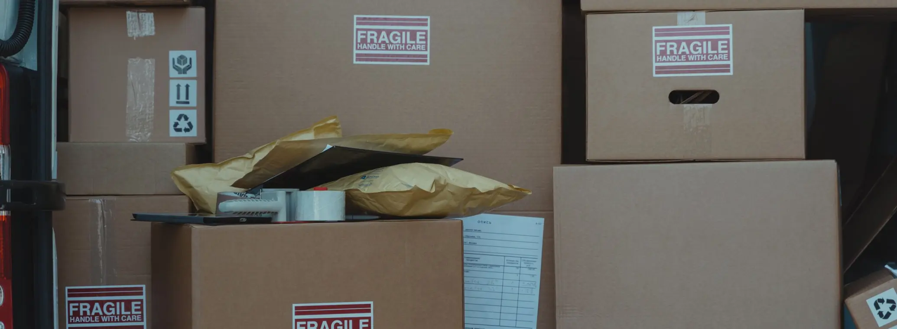

# Shipping from China to the USA in 2027: Delivery Times and Costs for D2C Brands

> **Quick answer:** A D2C parcel from China to the USA takes **3 to 5 business days by express courier**, **6 to 10 days on our standard DDP service**, and around **10 to 20 days by post**. Cost depends on the parcel's chargeable weight, its size and the service; our early 2026 shipping guide listed express to the US from about **$8.50 per kg** and postal from about **$3.20 per kg** as references. On top of shipping, **every parcel now pays US duty**. Ship DDP so your customer never pays at the door, and pack tight, because carriers charge for size as well as weight.

"How long does shipping from China take?" and "what does it cost?" are the first two questions every brand asks before fulfilling US orders from China. The honest answer to both is "it depends on the parcel", but it depends on a short list of things you can control.

This post goes through every way to get an order from China to a US customer, how long each takes, what drives the price, and what changed for 2027.

## Delivery times, by method

| Method | Typical time to the US | Tracking | Used for |
|---|---|---|---|
| Express courier (DHL, FedEx, UPS) | 3–5 business days door to door | Full | Premium, urgent or high-value orders |
| Our standard D2C service, DDP | 6–10 days | Full | Most D2C orders |
| Postal services | Around 10–20 days | Varies | Light, low-value items |
| Air freight, bulk | 5–10 days | Shipment level | Restocking a US warehouse or Amazon |
| Sea freight, bulk | 14–16 days to a West Coast port, plus 5–10 days for clearance and inland delivery | Shipment level | Large volumes of stock |

Times are from our [shipping times and costs guide](news-shipping-times-costs-china-2026.html), except our standard service. They are typical, not guaranteed: December peak volumes and customs checks both add days. Set the delivery promise on your store a little longer than these figures. If you are reading this in November, our [Christmas 2026 dispatch dates](christmas-2026-shipping-deadlines-from-china.html) give the last days to ship for delivery before Christmas.

## What shipping costs

Every quote for a D2C parcel comes down to four things.

**1. Chargeable weight.** Carriers charge the higher of the actual weight and the volume weight. For express, volume weight is usually length × width × height in centimetres divided by 5,000. A 30 × 20 × 15 cm box has a volume weight of 1.8 kg, even if the product inside weighs 600 g. Our [dimensional weight guide](dim-weight-packaging-optimisation-2026.html) shows how to cut it.

**2. The service.** Express costs most and arrives fastest. Postal costs least per kilogram and takes longest. Our standard DDP service sits in between.

**3. Surcharges.** Carriers add fuel surcharges that change often, and many add peak surcharges in the fourth quarter. They publish both on their own websites.

**4. Duty and clearance.** Every parcel from China now pays US duty, covered in the next section, and some carriers add a clearance or disbursement charge.

As references only, our early 2026 shipping guide listed these starting rates to the US:

| Service | Reference starting rate, early 2026 | Minimum |
|---|---|---|
| Express courier | From about $8.50 per kg | 0.5 kg |
| Postal | From about $3.20 per kg | 0.1 kg |
| Air freight, bulk | About $4.50–7.00 per kg for shipments over 100 kg | 21 kg |
| Sea freight, 20ft container to Los Angeles | About $2,000–2,350 per container | One container |

These are starting points from that date, not a quote. Rates move with fuel, season and volume, and the real price depends on your parcel's weight, size and destination. We quote every shipment.

## The duty on every parcel

Until 2025, most parcels under $800 entered the US duty-free. That exemption is suspended for goods from every country and repealed in law from **1 July 2027**. So every D2C parcel from China pays:

1. **The normal MFN duty** for its HTS code
2. **Any Section 301 list duty**, from 7.5% to 100%
3. **The 12.5% Section 301 forced labor duty**, since 24 July 2026, unless the product is exempt

On a $25 parcel with a 5% MFN rate on Section 301 List 4A, that is $6.26 of duty, a quarter of the value. Our post on [shipping D2C orders to the US in 2027](shipping-d2c-orders-china-to-us-2027.html) works through it line by line.

**Ship DDP.** Under DDP the duty is paid before delivery and your customer pays nothing at the door. Under DAP the carrier asks the customer for it with a handling fee, and refused parcels and chargebacks follow. Our [DDP explainer](ddp-shipping-from-china-explained-2026.html) covers the details.

## What changes on 20 January 2027

From **20 January 2027**, postal shipments subject to Section 301 duties, which covers goods from China, must use CBP's new **Entry Type 13** or a formal entry. CBP moved the date from 22 October 2026.

Express courier parcels are not affected by that change. Postal lines from China will need more data for each parcel, and some may change price or service. If you rely on postal shipping for light items, ask your provider now whether it will be ready.

Separately, a CBP proposal published on 8 October 2026 would require informal entries, which most express parcels use, to be filed on or before arrival. It is a proposal, with comments due by 7 December 2026, not a rule in force.

## Five ways to cut the cost per order

1. **Pack tight.** Right-size the mailer or box for each product. Dimensional weight is the most common avoidable cost on D2C parcels.
2. **Choose the service per product.** Light, low-value items can go by a slower service; premium items justify express.
3. **Get the HTS code right.** A wrong code can mean overpaying duty on every parcel, or a customs hold.
4. **Price the duty in.** Build it into each product's price instead of absorbing it as one blanket margin.
5. **Move heavy bestsellers in bulk.** Bulk import pays duty on wholesale value rather than retail value, and sea freight is far cheaper per unit. That is the [hybrid model](china-us-hybrid-fulfillment-model-2026.html).

## Where we sit in this

We ship D2C orders from our Shenzhen warehouse to US customers, DDP, with a standard delivery time of **6 to 10 days**, and by express when you need it faster. Pick and pack is **$0.99 per order** with standard packaging included, and we quote shipping per shipment on your actual products. For brands with US stock, we also consolidate and forward bulk shipments by air and sea. Our [China to US fulfillment page](china-to-us-fulfillment-2027.html) covers the full setup.

## The bottom line

Shipping from China to the USA takes 3 to 5 business days by express, 6 to 10 days on a standard DDP service and around 10 to 20 by post. The cost is set by chargeable weight, service, surcharges and duty, and duty is now on every parcel. Pack tight, ship DDP, check your HTS codes, and send heavy bestsellers in bulk.

[Send us your product sizes and weights](Contact-Us.html) and we will quote the real delivered cost to your US customers.

Delivery times and reference rates are as stated, and the US rules as at 8 November 2026. This is general information, not customs advice. Confirm duty on your products with a licensed customs broker.
