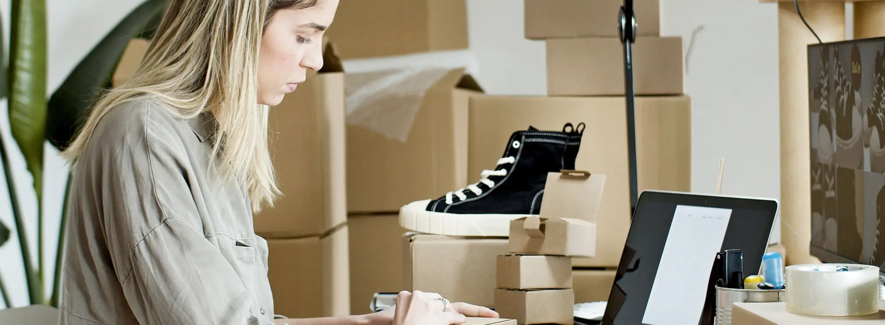

# When to Switch from Dropshipping to a China 3PL: 7 Signs It Is Time

> **Quick answer:** Switch when a few products sell steadily, when quality or delivery problems are costing you refunds and reviews, or when you want your own brand on the box. A China 3PL holds stock you have bought, checks it on arrival and ships each order in your packaging. You still ship from China, so delivery speed is similar, but you control quality, packaging and customs data. Start with your proven products only, keep dropshipping the rest, and test with a small batch.

Dropshipping is a good way to find out what sells. It is a poor way to build something that lasts, because the parts that make a customer come back, the product quality, the packaging and the delivery promise, all belong to someone else.

Most stores that grow past the testing stage reach the same point: a handful of products are selling every week, and the problems with dropshipping are now costing real money. This post covers the seven signs you are there, what actually changes when you move to a China 3PL, and how to switch without risking the store.

## Dropshipping vs a China 3PL, side by side

| | Dropshipping | China 3PL with your own stock |
|---|---|---|
| Who owns the stock | The supplier or agent | You |
| Upfront cash | None | You buy the stock first |
| Quality check | Usually none before shipping | Checked on arrival, before storage |
| Packaging | The supplier's | Yours, with inserts and branding |
| Product source | Whatever the supplier has that day | The factory and spec you chose |
| Customs data | Set by the supplier | Kept consistent by the 3PL, per product |
| Ships from | China | China |

The last row matters. Moving to a China 3PL does not make delivery much faster than good dropshipping. What it changes is everything else.

## The seven signs

### 1. A few products sell every week

If most of your revenue comes from a handful of products that sell steadily, you know enough to buy stock. That is the point where holding inventory stops being a gamble. If sales still jump between products week to week, keep testing.

### 2. Quality problems are costing you refunds

When a supplier switches factory, changes a material or ships a damaged item, you find out from a customer. With your own stock in a warehouse, every delivery is counted and inspected on arrival, so problems are caught before anything ships. Our post on [quality control at the source](news-quality-control-china-supplier.html) covers what that inspection looks like.

### 3. Customers ask "where is my order?"

Long or unpredictable delivery generates support tickets, chargebacks and poor reviews. A 3PL that holds your stock can tell you exactly when an order left and give you a delivery promise you can put on the product page.

### 4. You want your own brand on the box

A plain grey bag with a supplier's invoice inside does not build a brand. With your own stock you can use branded mailers, boxes, inserts and thank-you cards. We pack in your branded materials at the same **$0.99 per order** pick and pack rate. Our [branded packaging service](branded-packaging-kitting.html) shows the options.

### 5. Duty is eating your margin

Since the US de minimis exemption was suspended, every parcel from China to a US customer pays duty, whether it is dropshipped or not. The duty is the same either way. What changes is control. Dropshipped parcels carry whatever HTS code and description the supplier chooses, and a wrong code can mean overpaying on every order or a customs hold. A 3PL keeps the data consistent and ships DDP, so the duty is paid before delivery. Our post on [shipping D2C orders to the US in 2027](shipping-d2c-orders-china-to-us-2027.html) explains what each parcel pays.

### 6. Supplier stock-outs are killing your ads

Nothing wastes ad spend like an out-of-stock bestseller. When you own the stock, you can see exactly how many units are left and reorder before you run out.

### 7. You want to sell on more than one channel

Holding your own stock lets one inventory pool serve your Shopify store, TikTok Shop, Amazon and wholesale orders at once. Our [multi-channel fulfillment](multi-channel-fulfillment-china.html) page covers how that works.

If three or more of these sound familiar, it is time to look seriously at a 3PL.

## What it costs on each side

With dropshipping, you pay one price per order: product, packing and shipping bundled together by the supplier. With a 3PL, those are separate lines, which makes them easier to see and to control.

| Line | With us |
|---|---|
| Stock | Bought from your factory or supplier, up front |
| Receiving and standard inspection | Free |
| Storage | $0.49 per CBM per day; 30 days free for new customers when the first order ships within those 30 days |
| Pick and pack, standard packaging included | $0.99 per order |
| Shipping | Quoted per shipment by weight, size and destination |
| Duty, for DDP orders | Depends on the product and destination |

The real new cost is cash: you pay for stock before you sell it. That is why the switch should start with your proven products, in quantities you are confident of selling. Our [pricing guide](china-fulfillment-cost-pricing-2026.html) breaks down a full order.

## How to switch without risking the store

1. **Pick your two or three proven products.** Leave everything else on dropshipping for now.
2. **Get factory samples** and compare them with what your dropshipping supplier has been sending.
3. **Order a small first batch**, enough for a few weeks of sales, not a few months.
4. **Ship it to the 3PL**, where it is counted and inspected on arrival.
5. **Connect your store** and route only those products to the 3PL. The rest keep going to your dropshipping supplier.
6. **Run both side by side for a month.** Compare refunds, reviews and delivery times.
7. **Move the next products across** once the first batch is selling well.

Our guides on [moving from dropshipping to a branded D2C store](dropshipping-to-branded-d2c-store.html) and on [comparing AliExpress or CJ dropshipping with your own stock](aliexpress-cj-dropshipping-vs-own-stock-china-warehouse.html) go further into each step.

## When not to switch yet

Be honest with yourself about these:

- **You are still testing products** and no single product sells steadily.
- **You cannot afford to tie up cash in stock** for six to eight weeks.
- **Your margins only work at dropshipping prices** and would not survive a minimum order from a factory.

In any of these cases, stay with dropshipping a little longer. There is no shame in it, and switching too early is the most expensive mistake on this list.

## Where we sit in this

We hold stock for D2C brands in our Shenzhen warehouse and ship each order to the customer, in your packaging, with DDP to the main markets. Pick and pack is **$0.99 per order** with standard packaging included, receiving is free and there are no minimums. We work best for brands shipping 300 or more orders a month, and if you are below that, we will tell you honestly whether the switch makes sense yet. Our [dropshipping fulfillment](dropshipping-fulfillment.html) page explains how we work with stores making the move.

## The bottom line

Switch from dropshipping to a China 3PL when a few products sell steadily and the problems of not owning your stock, quality, packaging, stock-outs and customs data, start costing more than the cash it takes to buy inventory. Move your bestsellers first, keep testing the rest by dropshipping, and start with a small batch.

[Tell us which products you want to move first](Contact-Us.html) and we will cost them out with you.

Prices and rules as at 8 November 2026.
