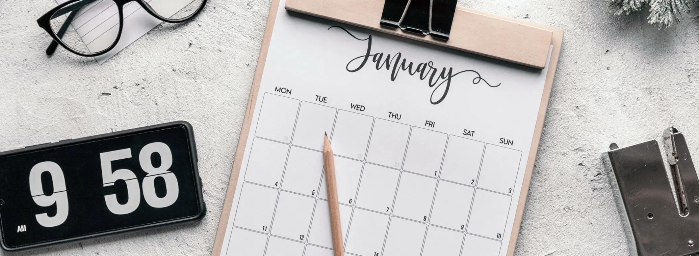

# US Import Changes in January 2027: A Calendar for Brands Shipping from China

> **Quick answer:** Six dates land in five weeks. **5 January**: a foreign importer of record must be CTPAT-validated or use a CTPAT-validated customs broker. **8 January**: CPSC certificate eFiling extends to foreign trade zone entries. **10 January**: the announced end of the extended US-China trade truce. **15 January**: Amazon's 2027 US FBA fees start. **20 January**: Entry Type 13 becomes mandatory for postal parcels from China. **6 February**: Chinese New Year. None of them brings back duty-free parcels.

January is usually a quiet month for brands shipping from China. January 2027 is not. US customs, product safety, trade policy and Amazon's fees all change within a few weeks of each other, just before Chinese New Year.

This is the calendar, with what each change means and what to check now. Each date links to the source we used.

## The calendar

| Date | Change | Who it affects |
|---|---|---|
| Tue 5 January | Foreign importer of record rule | Any importer of record based outside the US |
| Fri 8 January | CPSC eFiling for foreign trade zone entries | Regulated consumer products entering from an FTZ |
| Sun 10 January | Announced end of the extended US-China truce | Anyone paying US duty on goods from China |
| Fri 15 January | Amazon 2027 US FBA fulfilment fees | FBA sellers |
| Wed 20 January | Entry Type 13 mandatory for postal parcels | Postal shipments subject to Section 301 and similar duties |
| Mon 1 February | Amazon storage changes | FBA sellers |
| Fri 5 February | DHL Express demand surcharge ends; our last dispatch before Chinese New Year | Express shippers; our customers |
| Sat 6 February | Chinese New Year; our warehouse closed 6 to 14 February | Everyone sourcing or shipping from China |
| Thu 1 July | US de minimis repealed in law | Every parcel to the US |

## 5 January: the foreign importer of record rule

CBP published an interim final rule, **Heightened Requirements for Foreign Importers of Record**, on 6 November 2026. From **5 January 2027**, an importer of record based outside the United States may enter goods for consumption only if:

- it is validated under **CTPAT**, CBP's supply chain security programme, or
- it designates a **licensed customs broker that is CTPAT-validated**.

CBP says only Canadian foreign importers are currently eligible for CTPAT validation. In practice, a foreign importer anywhere else needs a validated broker. Law firms report that the rule also adds data fields to the entry forms, requires brokers to verify their clients' status, and applies to goods cleared on or after 5 January, including goods already on the water. Comments on the rule are open until 5 January, so details may still change.

**What to check now.** Find out who the importer of record is on your shipments: you, your supplier, your forwarder or your DDP provider. If it is a company outside the US, ask whether its broker is CTPAT-validated, and get the answer in writing before your January shipments clear. Our post on [who the importer of record is](importer-of-record-china-fulfillment-2026.html) explains the role, and if you ship US DDP parcels with us, [contact us](Contact-Us.html) and we will confirm how your parcels clear.

## 8 January: CPSC eFiling reaches foreign trade zones

Since **8 July 2026**, importers of consumer products covered by a CPSC safety rule have had to file their certificate data electronically at entry, including for low-value shipments. From **8 January 2027**, the same applies to goods entering from a **foreign trade zone**.

If you sell children's products or other regulated consumer goods, the certificate data (manufacture date, test date and lab details) must be ready before the goods clear. Our guide to [product compliance when importing from China](product-compliance-importing-from-china-2026.html) covers which certificates apply.

## 10 January: the US-China truce extension ends

In November 2026 the US and China extended their trade truce by two months. The US Treasury Secretary said it would run until **10 January 2027**. Trade press reported that the White House had not yet formally documented the extension, so treat the date as announced rather than final.

What happens after 10 January is not known as we write. Watch for an announcement in the first week of January, and price your Q1 orders with a margin for change. Our [Section 301 and forced labor duty guide](section-301-forced-labor-tariff-china-2026.html) covers the duties that apply now.

## 15 January and 1 February: Amazon's 2027 fees

Amazon announced its 2027 US fee changes on 5 November 2026. According to reports of the announcement:

- **15 January**: most FBA fulfilment fee changes start, an average of about **$0.19 more per unit sold**, varying by size and price.
- **1 February**: storage changes start. The storage utilisation surcharge ends, and aged inventory charges merge into a single age-based monthly storage rate.
- **1 March**: age-based storage pricing in Amazon Warehousing and Distribution.

The lesson for brands sourcing from China is the same as every year: keep less stock sitting in Amazon and top it up more often. Our post on [Amazon FBA inbound placement fees](amazon-fba-inbound-placement-fees-2026.html) covers the inbound side.

## 20 January: Entry Type 13 becomes mandatory

**Entry Type 13** is CBP's informal entry for international postal shipments. CBP moved the mandatory date from 22 October 2026 to **20 January 2027**. From then it is required for postal parcels subject to Section 201, 232 or 301 duties or to partner government agency rules, which covers most goods from China.

In October 2026, CBP also proposed applying it to **all international mail packages valued at $2,500 or less**. That proposal is not final.

If you ship by postal lines to the US, check that your provider is ready to file Entry Type 13 with complete data: the sender, the postal tracking number, a clear description, HTS code and value. Entry Type 13 covers postal shipments only; express courier parcels clear under the courier's own entry types.

## 6 February: Chinese New Year

Chinese New Year 2027 falls on **Saturday 6 February**. Our Shenzhen warehouse is closed from **6 to 14 February** and reopens on Monday 15 February, so **Friday 5 February is the last dispatch day**. Factories wind down earlier than that. Our [Chinese New Year 2027 guide](chinese-new-year-2027-shipping-deadlines.html) has the production and freight cut-offs, and our [Valentine's Day 2027 post](valentines-day-2027-shipping-deadlines-from-china.html) has the last dispatch dates by market.

## What does not change

**The de minimis exemption stays gone.** It remains suspended and is repealed in law from **1 July 2027**. Every parcel from China to a US customer pays duty: the MFN rate, any Section 301 list duty and the 12.5% Section 301 forced labor duty. Our guide to [shipping D2C orders to the US in 2027](shipping-d2c-orders-china-to-us-2027.html) shows what each parcel pays.

## Your January checklist

1. **Find out who your importer of record is**, and whether its broker is CTPAT-validated.
2. **Check your CPSC certificates** if you sell regulated consumer products.
3. **Re-check landed costs after 10 January**, once the truce position is known.
4. **Review your Amazon stock levels** before the new storage rates start on 1 February.
5. **Confirm Entry Type 13 readiness** if you ship by postal lines.
6. **Get stock into your warehouse by mid-January**, ahead of Chinese New Year.

## Where we sit in this

We pick, pack and ship D2C orders from our warehouse in Shenzhen, with DDP to the US, UK, EU, Canada and Australia, and prepare and ship stock to Amazon FBA. Pick and pack is **$0.99 per order** with standard packaging included, receiving is free and there are no setup fees or minimums. We are not a law firm, and customs decisions about your products belong with you and a licensed customs broker.

[Ask us how these changes affect your shipments](Contact-Us.html).

Dates and rules as at 26 November 2026, from the sources below. Several are interim or announced rather than final, so check the current position before you act.

**Sources:** CBP interim final rule on foreign importers of record, as summarised by [Troutman Pepper](https://www.troutman.com/insights/know-your-importer-cbp-ends-the-era-of-the-anonymous-foreign-importer-of-record/) and [Livingston International](https://www.livingstonintl.com/interim-final-rule-on-for-u-s-foreign-importers-of-record-ctpat-validation-is-required/); [CPSC on mandatory eFiling](https://cpsc.gov/Newsroom/News-Releases/2026/CPSC-Implements-Mandatory-eFiling-for-Certificates-of-Compliance-Targeting-Dangerous-Foreign-Imports) and [Bureau Veritas on the FTZ date](https://www.cps.bureauveritas.com/newsroom/us-cpsc-publishes-16-cfr-1110-final-rule); [Supply Chain Dive on the truce extension](https://www.supplychaindive.com/news/us-china-officially-extend-trade-war-truce-by-2-months/874107/); [PPC Land on Amazon's 2027 fees](https://ppc.land/amazon-sellers-face-average-0-19-fba-fee-rise-from-january-15-2027/); [BDO on Entry Type 13](https://www.bdo.com/insights/tax/cbp-extends-mandatory-entry-type-13-date-for-international-mail-to-january-20-2027) and [CBP's proposed rule](https://cbp.gov/newsroom/national-media-release/cbp-proposes-new-rule-strengthen-enforcement-and-limit-duty).
